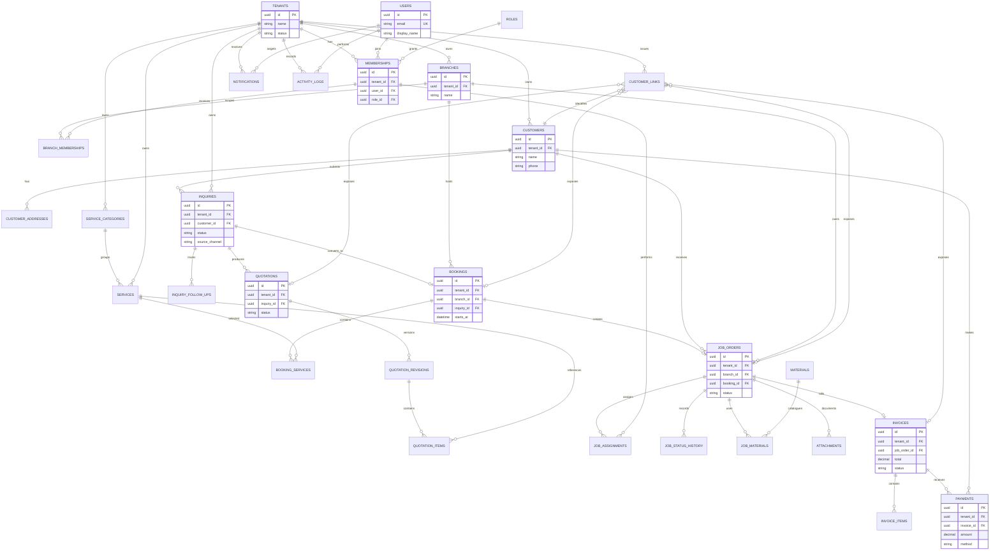

# Entity Relationship Diagram

**Phase:** Phase 5 - Database Architecture  
**Status:** Draft for founder approval  
**Date:** 2026-11-10

The following conceptual ERD describes the MVP data model. It is not a
migration or executable schema.

## Modeling notes

- `MEMBERSHIPS` represents tenant membership; `BRANCH_MEMBERSHIPS` represents
  branch scope and avoids assuming all users have tenant-wide access.
- `QUOTATION_REVISIONS` preserves approved quotation history.
- `JOB_STATUS_HISTORY` preserves operational state changes.
- Payment status is derived from invoice totals and verified payments, not
  treated as a substitute for job status.
- Attachments store metadata and reference tenant-aware external object storage.
